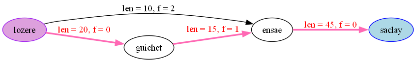
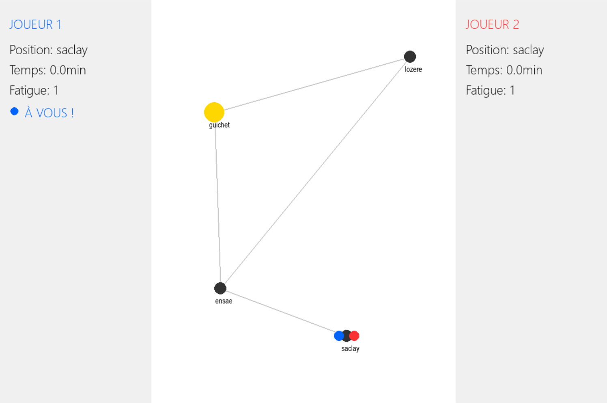

# Recherche de chemin sous contrainte de fatigue

> 🇬🇧 [English version](README.md)

**Trouver l'itinéraire le plus rapide quand chaque pas fatigue un peu plus** : de Dijkstra à A\* sur des graphes d'états, avec analyse de complexité et un jeu à deux joueurs.

*ENSAE Paris · Projet de programmation de 1re année (2026) · Samuel Placek & Emmanuelle Chocron*



## Le problème

Un agent se déplace dans un réseau de routes. Chaque route a une **longueur** et un **coefficient de fatigue**. Le temps pour parcourir une route est sa longueur multipliée par la fatigue actuelle de l'agent, et **la fatigue ne fait qu'augmenter** au fil du trajet.

L'objectif est d'atteindre l'arrivée en un **temps total minimal**. Comme la fatigue dépend du chemin déjà parcouru, passer par le même carrefour avec deux niveaux de fatigue différents n'est pas la même situation. Un algorithme de plus court chemin classique ne suffit donc pas.

## Démarche

*n = nombre de sommets, m = nombre d'arêtes, k = nombre d'états (sommet, fatigue) explorés*

| Étape | Idée | Complexité |
|---|---|---|
| **1.1 Sans fatigue** | Se ramener à un graphe pondéré et appliquer **Dijkstra** avec un tas binaire | O((n + m) log n) |
| **1.2 Avec fatigue** | Construire un **graphe d'états étendu** dont les sommets sont des paires (sommet, fatigue), exploré en largeur (BFS) ; des « super-nœuds » d'arrivée regroupent tous les niveaux de fatigue à destination, puis Dijkstra est réutilisé tel quel | O(k² + mk) pour la construction |
| **1.3 Graphe implicite** | Ne générer que la partie utile du graphe étendu : une sous-classe `GraphImplicit` calcule les voisins **à la demande** | O(mk / n) pour la génération des voisins |
| **2.1 Élagage** | Un « oracle » écarte les états **Pareto-dominés** (atteints avec à la fois plus de fatigue et plus de temps) | Moins d'états explorés |
| **2.2 A\*** | **Heuristique admissible** : la fatigue ne diminuant jamais, le temps restant vaut au moins *plus courte longueur restante × fatigue actuelle*. Toutes les longueurs restantes sont obtenues par **un seul Dijkstra inversé** depuis l'arrivée | O((mk / n) log k) |

Le raisonnement complet et les preuves de complexité sont détaillés dans [docs/details-techniques.md](docs/details-techniques.md).

## Jeu à deux joueurs



Deux joueurs partent du départ et doivent atteindre l'arrivée ; le temps total le plus faible l'emporte. Le moteur de jeu propose deux interfaces qui partagent la même logique :

- **Version terminal** : aucune dépendance externe, saisies sécurisées, position / temps / fatigue affichés à chaque tour. Fonctionne sur des environnements cloud comme Onyxia.
- **Version Pygame** : sommets placés automatiquement sur une grille avec un léger décalage aléatoire pour éviter les chevauchements, voisins accessibles surlignés en vert, arrivée en or.

## Structure du projet

```
code/
  network.py   Classe Network : routes, longueurs, fatigue ; construit les graphes simple, étendu et implicite
  graph.py     Classes Graph et GraphImplicit : Dijkstra, élagage de Pareto, A*
  game.py      Jeu à deux joueurs (terminal et Pygame)
  main.py      Point d'entrée interactif : lancer les tests, exécuter une fonction sur un réseau, ou jouer
  answers.py   Réponses aux questions du projet
examples/      Réseaux de test : small, medium et large, chacun sans / avec peu / avec beaucoup de fatigue
tests/         Tests unitaires (unittest et pytest)
assets/        Images : réseau d'exemple (Graphviz) et capture du jeu
docs/          Raisonnement détaillé et preuves de complexité (français et anglais)
```

## Lancer le projet

```bash
pip install -r requirements.txt
python code/main.py
```

`main.py` ouvre un menu interactif :

1. **Lancer les tests**
2. **Exécuter une fonction** de `answers.py` sur le réseau de votre choix (par exemple `small.txt`) ; le menu demande chaque argument
3. **Jouer au jeu à deux joueurs**, dans le terminal ou avec Pygame

Les tests peuvent aussi être lancés directement avec `python -m pytest tests/`.

Le rendu des graphes nécessite aussi le logiciel [Graphviz](https://graphviz.org/download/) (`brew install graphviz` sur macOS, `sudo apt-get install graphviz` sur Ubuntu ; sous Windows, cocher *« Add Graphviz to the system PATH »* à l'installation).

## Auteurs

**Samuel Placek** · **Emmanuelle Chocron** : ENSAE Paris
